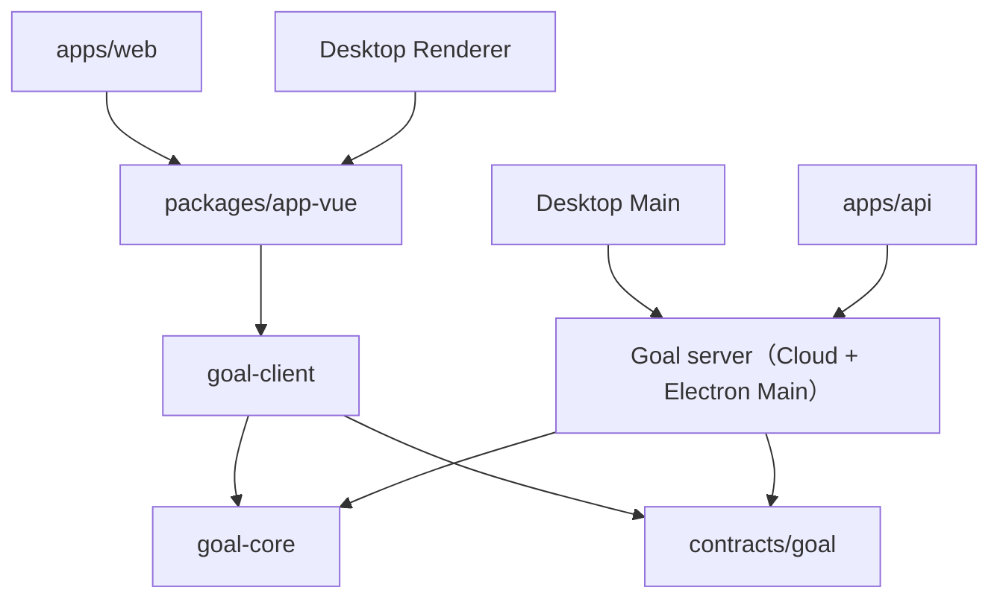

# Goal 业务包运行时边界（Issue #630）

> 状态：Goal 第一阶段试点。基于 `origin/main` 的独立重构分支，未覆盖其他 CI/CD 工作树。

## 决策

Goal 的传输 Schema 继续由 `@memoflow/contracts/goal` 权威维护。以运行时依赖方向为依据，新增：

- `@memoflow/goal-core`：没有 HTTP / IPC / Prisma / Electron / Vue 依赖的标识符工厂与进度算法。服务端和客户端共同使用相同的进度计算。
- `@memoflow/goal-client`：客户端聚合映射与访问接口，HTTP 和 IPC 都在这个包实现，不允许从 `@memoflow/goal`（服务端领域实现）导入。
- `@memoflow/goal`：保留服务端领域逻辑、API / Electron 宿主服务、持久化适配器、调度事件投影等。旧客户端子入口 `@memoflow/goal/client` 迁移为 `@memoflow/goal-client`。

## 前端数据建模约定

- **DTO / Schema** 是 HTTP、IPC 和持久化转换边界的输入输出，不将服务端 ORM Entity 传给 UI。
- **Domain** 仅承载实际不变量与跨端共享算法。纯函数和结构化数据为默认；有行为和受控状态生命周期时才使用 Class。
- **ViewModel** 由 Vue Composable / `computed` 或纯 mapper 从 DTO 生成，用于渲染状态、标签、展示格式和暂存编辑状态。
- `GoalClientPort` 现仍返回部分带 `toDTO()` 方法的客户端 Class。为了保持现有 Web/Desktop/Mobile 行为，**第一阶段只迁移包边界，不改变返回值契约**。日后逐消费者迁移为 DTO/ViewModel，再淘汰无行为的包装对象。
- 核心不变量不应仅存在于 ViewModel。最终持久化的写入规则由 Cloud API 或 Electron Main 宿主的领域用例负责验证。

## Nx affected 实测

基于 `NX_DAEMON=false node node_modules/nx/dist/bin/nx.js show projects --affected --files=<path> --json`：

| 模拟变更                                                             | 主要结果                                                                                       |
| -------------------------------------------------------------------- | ---------------------------------------------------------------------------------------------- |
| `packages/goal-client/src/application-client/goal-client-service.ts` | affected 包含 goal-client / app-vue / web / app-react / mobile / desktop；**不包含 goal、api** |
| `packages/goal/src/server/domain/aggregates/goal.ts`                 | affected 包含 goal / api / desktop；目前仍包含 web / app-vue 等客户端 Project                  |
| `packages/contracts/src/modules/goal/api/goal-crud.dto.ts`           | affected 广泛传播，符合跨运行时公共契约更改的预期                                              |

后两种情况表明：**Project 拆分本身不保证服务端变更不传播至 UI**。剩余依赖包含：

- `packages/notification` 的服务端集成测试从 `@memoflow/goal/schedule-execution` 和 `@memoflow/goal/schedule-projection` 导入，静态扫描构成 `notification → goal`；`app-vue → notification` 因而扩大 affected。
- `apps/web` 的跨桌面测试 / 视觉 E2E 配置引用 `apps/desktop` 文件，形成 `web → desktop → goal`。

不能为了缩减影响范围而删掉这些真实集成测试。下一阶段应把「仅供跨 Project 集成测试使用的依赖」迁入合适的验证 Project，或者让任务级图与测试归属表达跨项目验证，而不是污染运行时应用的静态依赖。

## 下一阶段（不在第一阶段直接修改）

1. 对 `packages/app-vue/src/modules/goal` 的 90 个文件做边界审计；先处理引用全局 Shell、DI、Locale、AI / Repository 跨域 Composable 的耦合，再考虑独立 `goal-ui` Nx Project。
2. 审核 `GoalClientPort` 返回的 Class 是否有实际领域行为；逐处移除不必要的 `Goal → toDTO() → Store` 往返，保持数据 Schema 和功能测试。
3. 选择 Task 垂直切片重复 Client / Core / Server 分层；避免引入互相引用的 `goal-contracts ↔ task-contracts`。
4. 对比基线与迁移后 affected 的 Project 和任务集合，区分运行时依赖与测试专用依赖。
5. 完成 Web、Desktop、Mobile 的集成/打包验证后，再考虑合并。

## 必须保持

`@memoflow/contracts/*` 公共协议、Goal DTO、HTTP/IPC 通道、PowerSync / Prisma 数据映射、本地 Profile 边界、离线读写语义、Desktop 原生窗口和认证边界、用户可见路径与现有测试主流程。
