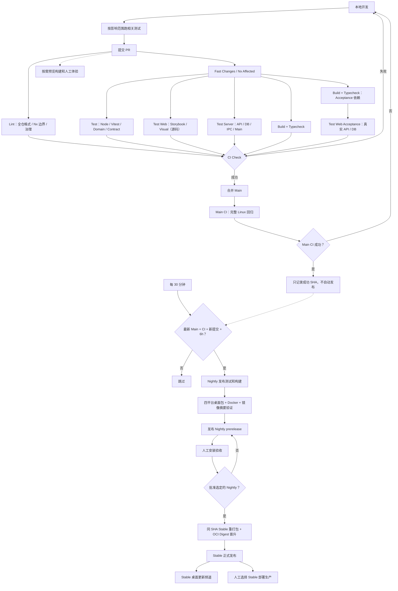

# MemoFlow CI/CD VNext：Nightly → Stable

关联 [Issue #628](https://github.com/BakerSean168/memoflow/issues/628)。本文同时说明**目标架构**与**当前实现的现实状态**，避免将“Nightly 资格检查”误认为已经交付可安装的 Nightly。

## 目标：完整开发与交付链路

## 事件与测试矩阵

| 阶段            | 触发                                 | 验证                                                                      | 是否自动发版      |
| --------------- | ------------------------------------ | ------------------------------------------------------------------------- | ----------------- |
| 本地开发        | 源码修改                             | 相关 Unit / Component / Integration                                       | 否                |
| PR              | Pull request                         | Nx Affected / Lint / Build / Typecheck / Browser / Contract / Integration | 否；预览按需      |
| Main            | 合并后 push                          | 完整 Linux 常规回归，CI Check 收据                                        | **否**            |
| Nightly 检查    | 每 30 分钟                           | 最新 main SHA、成功 exact-SHA Main CI、Git ancestry、距最近 Nightly >= 6h | 不满足时跳过      |
| Nightly Release | 满足上面条件                         | 发布测试、安装包/镜像/更新链验收、exact SHA 和 digest                     | 是，仅 prerelease |
| Stable          | 显式人工选择已发布 Nightly           | 校验 Nightly CI/产物、相同源码 SHA、版本和渠道                            | 仅人工确认        |
| Production      | 手动选择已发布且非 prerelease Stable | Manifest、OCI digest、发布 SHA、回滚能力                                  | 不自动            |

Nightly Audit 是扩展测试，不等于 Nightly Release；Main CI 成功也不等于必须创建候选产物。

## 资格判定规范

- 每小时第 8 和 38 分钟检查，合计每 30 分钟一次；不是每 30 分钟都发版。
- 始终从 GitHub API 获取 main 当前 HEAD SHA，且要求该 SHA 的 push/main CI 已成功，具体 CI Check Job 为成功。过期 commit、PR 事件、单个任务绿灯都不够。
- 找最近的已发布 Nightly prerelease（标记为 vX.Y.Z-nightly.YYYYMMDD.RUN），忽略草稿、Stable 和其他 prerelease；若 SHA 相同，跳过；若祖先关系不成立，禁止生成。
- 新 main 必须严格比该 Nightly 有更新提交，且距上次 Nightly 发布至少 6 小时；没有任何 Nightly 时允许首发，但必须有完整 Main CI。
- API、SHA、Tag、发布时间、版本号等不可信或缺失时失败封闭，不得以未找到结果解释为成功。资格判定必须对同一个 main SHA 的根 package、Desktop package、Release Please manifest 做版本一致性校验，并在完成检查后再次确认 main HEAD 未变化；正式发布前还要重新校验以避免检查与构建之间的竞态。
- 通过 Actions concurrency 序列化定时与人工重试，运行中不取消旧发布。Fast skip 不安装 pnpm、Node 依赖或 Docker。

## Nightly 到 Stable：产物契约

- Nightly：Windows x64 NSIS/ZIP、Linux AppImage/deb/rpm、macOS x64/ARM64 DMG/ZIP、API/Web/Migrator OCI 镜像及运行时，必须有 Nightly 独立更新频道和可校验的安装/镜像摘要；不修改生产 selector。
- Stable 必须来自人为明确选择并验收的某个 Nightly（不局限最新），锁定其 Git SHA、CI run、Release Manifest、Docker Digest 和验收收据。
- Docker 可通过 immutable digest 直接晋升 Stable tag，无须重新构建不同 digest 的镜像。ACR/GHCR 的对应 digest 必须相同。
- Desktop Nightly 与 Stable 的版本、签名或更新频道不同，必要时必须**同一 SHA 重打包**，不能把夜版安装包简单改名。构建元数据发生变化应明确记录新产物摘要。
- 不能为修改 Release Please 的版本号再引入一个隐蔽的新 Git SHA；稳定版最终源码必须仍是选定 Nightly 的 SHA。
- Production 仍通过人工 workflow_dispatch 选择已发布非 prerelease Stable、验证 digest，并保持回滚。

## 现有路径与迁移边界

| 当前组件              | 迁移时的职责                                                                   |
| --------------------- | ------------------------------------------------------------------------------ |
| ci.yml                | 职责型 Job 家族、Nx task inputs 选择、唯一 primary receipts 与 Main 全量 Linux |
| candidate-publish.yml | 旧 Main CI 成功自动构建候选；新 Nightly 产物链可用后再一次性取消自动触发       |
| release-publish.yml   | 旧候选成功自动进入 Release；新 Stable 必须只能手动选择一个验证过的 Nightly     |
| release-assets.yml    | 沿用多平台打包与安装、签名、更新合同，支持独立 Nightly 和 Stable               |
| publish-images.yml    | 采用 OCI immutable digest 晋升，不重复构建                                     |
| nightly-audit.yml     | 保持独立夜间扩展回归，而不是发行 Nightly                                       |
| deploy-production.yml | 人工验证并选择 Stable，严禁 Nightly 直接部署生产                               |

### 当前已实现与未实现

**已经实现**：独立 Node Nightly eligibility 判定、可模拟 GitHub API 的正反面测试、纯只读且无需安装依赖的 Nightly 定时/手动预检 Workflow、本计划与触发矩阵。P1 调度已在同一 Draft PR #629 中实现：Lint 与 Changes 并行；Nx 23.3 task input adapter 选择 build/typecheck/test；Test 保留三路 LPT 和 app-vue 二分片；Server 按历史耗时分片，每个 runner 准备一次 Postgres schema；源码 Browser/Visual 无后端 build 依赖，Acceptance 单独消费后端 artifact。Check 验证 manifest、run/attempt/SHA、命令和每个 task/shard 的唯一成功 receipt，合法 skip 必须与计划一致。Main 常规 CI 不采集 coverage，统计保留在 Nightly Audit。

**尚未实现**：Nightly 的四平台产物构建、实际 Nightly prerelease 发布、人工 Stable 晋升以及关闭旧 Candidate 自动触发。当前 Nightly eligibility Workflow 无任何仓库写权限或构建任务，即使标记 eligible 也只产生决策摘要，不能被当作发布产物。

为了不造成旧发布中断，旧 Main→Candidate→Release 路径必须等 Nightly 和 Stable 两条新流程完成 dry-run、负向契约及真实 CI 验证后，才原子切换。该迁移不会自动执行真实 Stable 发布或生产部署。

### 后续严格串行切片

1. 接通 eligibility → 完整 Nightly（多平台 Desktop、Docker、Nightly Update、Release Manifest 和验收门禁）。
2. 增加手动选择任意已发布 Nightly 的 Stable 晋升；绑定 exact SHA，同 SHA Desktop 重打包，Docker digest 晋升；测试拒绝错误 SHA、缺少收据、版本冲突、签名/渠道不一致。
3. 在与历史 Release 兼容且可恢复的条件下关闭旧 Candidate/Release 自动触发；确保 Main CI 到此结束。
4. 用真实 PR CI 验证 P1 调度，记录关键路径和 runner-minutes；业务包 Server/UI 拆分留到后续独立优化。

每个切片须分别取得测试、YAML parse、Prettier/Governance、GitHub PR CI 证据。发布和生产部署动作始终需要独立授权。

## P1 选择与执行证据

`node tools/ci-cd-platform/replay-ci-matrix.mjs` 回放 docs-only、app-vue Chat、AI Server、Desktop Main、Desktop Renderer、API route、Task Server、contracts、workflow/root、test-only 和 Main docs、Task client 共 12 个现有文件场景；固定预期在 `tools/ci-cd-platform/__tests__/fixtures/pr-dispatch-matrix.json`，重放报告在 `reports/ci-cd-platform/p1-acceptance-matrix.json`。报告明确区分真实 Nx 选出的任务和尚未执行的产品测试，不能把规划回放当成 suite 执行成功。

未知或已删除项目 owner 以及 selector 异常扩大为完整验证。测试文件仍按 Nx production/default inputs 区分 build 与 typecheck。客户端与共享生产输入保留到 Browser/Acceptance 宿主回归的 Nx 传播；仅明确的 server/infrastructure-server/electron 路径适用资源排除。Server primary suite 唯一归属一个 shard，Desktop boundary 聚合入口由 IPC/Main 两个 primary target 代替；contracts 的 contract 集合与 Unit 不重复执行。后端 build 的重复项属于 artifact 依赖构建，不是重复 primary test。

实际执行以本次 GitHub run 的 `ci-task-receipts-*`、`web-shard-receipt-*` 和 `delivery-run-summary-*` artifact 为准。汇总报告提供 setup、执行、最长 job 执行、wall clock 和 GitHub runner-minutes；最长 job 执行不包含依赖等待，不能冒充完整 DAG 关键路径。P1 验收前仍须检查真实 PR CI；当前文档不宣称已测得提速。
