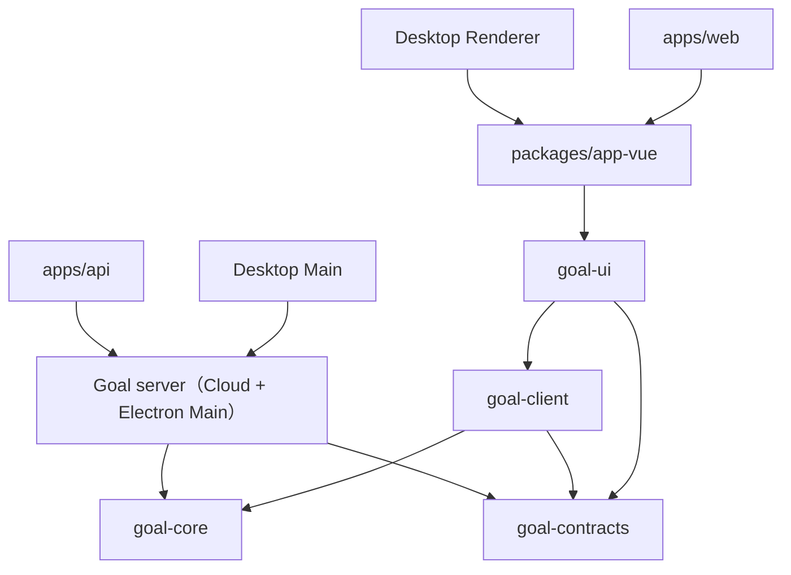

# Goal 业务包运行时边界（Issue #630）

> Goal 的契约、核心规则、客户端、服务端与 Vue UI 各自独立；宿主负责装配。

## 决策

Goal 的传输 Schema 继续由 `@memoflow/goal-contracts` 权威维护。以运行时依赖方向划分：

- `@memoflow/goal-core`：没有 HTTP / IPC / Prisma / Electron / Vue 依赖的标识符工厂与进度算法。服务端和客户端共同使用相同的进度计算。
- `@memoflow/goal-client`：直接返回 DTO 的客户端访问接口，HTTP 和 IPC 都在这个包实现，不允许从 `@memoflow/goal`（服务端领域实现）导入。
- `@memoflow/goal-ui`：Goal 的 Vue 组件、路由、Composable、Store 与草稿检查点。宿主通过公共入口消费，经 `host` 入口绑定现有平台能力；UI 不导入 app-vue 或其他业务 UI 实现。
- `@memoflow/goal`：保留服务端领域逻辑、API / Electron 宿主服务、持久化适配器、调度事件投影等。旧客户端子入口 `@memoflow/goal/client` 迁移为 `@memoflow/goal-client`。

## 前端数据建模约定

- **DTO / Schema** 是 HTTP、IPC 和持久化转换边界的输入输出，不将服务端 ORM Entity 传给 UI。
- **Domain** 仅承载实际不变量与跨端共享算法。纯函数和结构化数据为默认；有行为和受控状态生命周期时才使用 Class。
- **ViewModel** 由 Vue Composable / `computed` 或纯 mapper 从 DTO 生成，用于渲染状态、标签、展示格式和暂存编辑状态。
- `GoalClientPort` 直接返回 Goal / KeyResult / Record / Review DTO。消费方直接读取数据，不经过无行为 Class 或 `toDTO()` 胶水；HTTP/IPC 的字段和 Schema 保持不变。
- 核心不变量不应仅存在于 ViewModel。最终持久化的写入规则由 Cloud API 或 Electron Main 宿主的领域用例负责验证。

## 宿主装配

`app-vue/src/di/goal-ui-host.ts` 将宿主已有的 DI 键、平台组件、时间/翻译函数、缓存和跨域读端口绑定到 `goal-ui/host`。Web、Desktop 和 Storybook 在挂载前装配；绑定只保存能力引用，用户数据仍由原来的 DI、缓存、时间和 i18n 所有者管理。第 0 步的 surface 状态、离开守卫和原生编辑端口继续由 shell 提供，生命周期语义不变。

语言资源与 i18n 插件留在 app-vue。迁移的单元测试通过 Vitest 的测试宿主别名读取原有 fixture 和装配器；这些文件作为 goal-ui 的 Nx 命名输入参与缓存，不产生反向运行时依赖。与真实 shell 交互的深链与布局集成测试留在 app 层。测试用的 `composables/useGoal` 子入口与包根消费同一模块，保证 mock 和实际组件使用同一实例。

## 必须保持

Goal 公共协议与 DTO、HTTP/IPC 通道、PowerSync / Prisma 数据映射、本地 Profile 边界、离线读写语义、Desktop 原生窗口和认证边界、用户可见路径与现有测试主流程。
